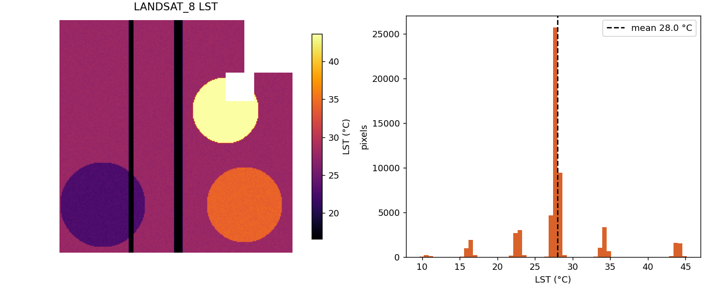
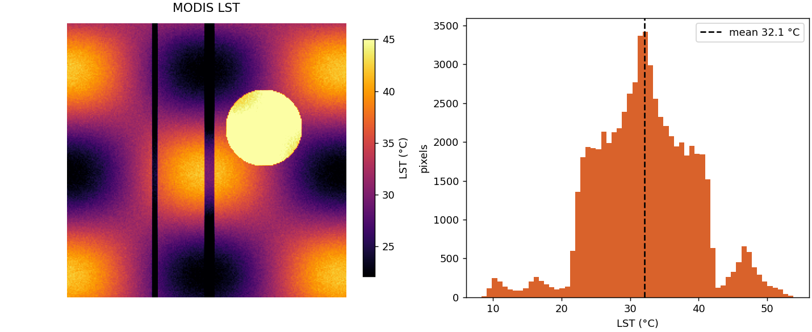
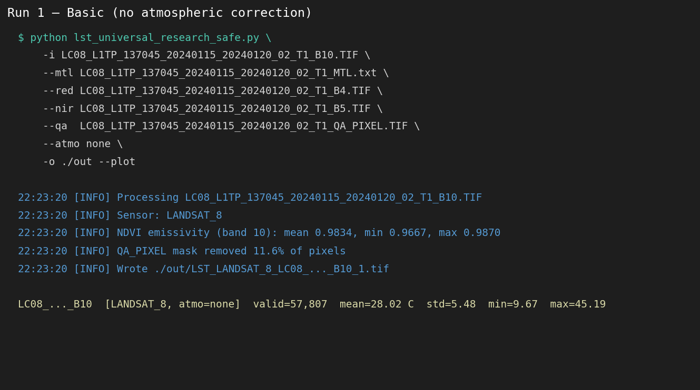
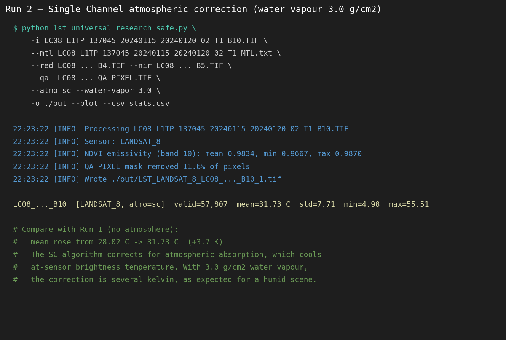
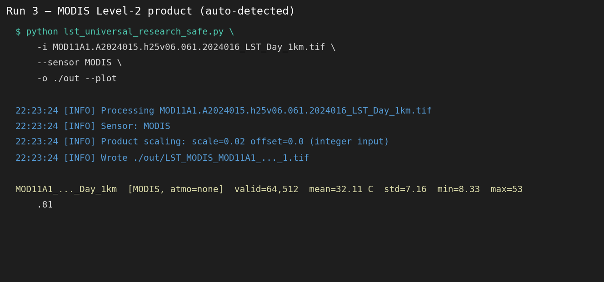

# Automated Land Surface Temperature (LST) Mapping

A Python tool for converting satellite thermal imagery into **land surface temperature (LST) maps** and exploring temperature patterns over space and time.

Supports Landsat 8/9, MODIS, ECOSTRESS, and ASTER inputs. The appropriate input bands and processing steps differ by sensor.

> **Research status:** This project includes experimental workflows. Validate outputs, masks, input units, and model assumptions before using the results in publications.

## 1. What is this tool?

This command-line tool reads supported satellite rasters and writes a georeferenced **LST GeoTIFF in °C**. You can use an already-corrected surface-temperature product or retrieve LST from raw Landsat thermal data using specified calibration and emissivity inputs.

**Important:** The basic brightness-temperature plus emissivity correction (`--atmo none`) **does not correct for atmospheric effects**. For Landsat, the USGS Level-2 `ST_B10` product is a simpler starting point for most research applications.

## 2. Functions

| Function | What it does | Availability |
|---|---|---|
| LST mapping | Convert supported satellite temperature bands to °C and export GeoTIFF | Standard |
| Landsat Level-1 retrieval | Convert thermal DN to radiance / brightness temperature and estimate LST | Standard |
| Atmospheric correction | Optional single-channel (`sc`) or split-window (`sw`) retrieval; requires water vapour | Standard; validate applicability |
| Emissivity estimation | Supply a constant, emissivity raster, or derive it from Landsat red + NIR | Standard |
| Cloud masking | Use Landsat `QA_PIXEL` to mask clouds, shadows, and fill | Optional |
| Batch processing | Process multiple scenes and export CSV statistics | Standard |
| Comparison | Compare with USGS `ST_B10` or suitable surface-temperature station measurements | Optional |
| LST downscaling | Predict finer-scale LST using Ridge, Random Forest, boosting, or an ensemble | **Experimental**, opt-in |
| Temporal trends | Calculate temporal mean, observation counts, and Theil–Sen slope | **Experimental**, opt-in |

Statistical downscaling produces a **modelled** high-resolution map, not a new direct thermal observation. Automatic ERA5 acquisition, full cross-sensor QA, and SHAP interpretation are **not yet implemented**.

## 3. How to use it

### Install

Requires Python 3.10+ (recommended). Clone the repository and install the core dependencies:

```bash
git clone https://github.com/Bipul-roy-AI/Automated-Land-Surface-Temperature-LST-Mapping.git
cd Automated-Land-Surface-Temperature-LST-Mapping
pip install -r requirements.txt
```

To run the experimental research commands, install the additional packages:

```bash
pip install scikit-learn scipy joblib
```

### A. Quickest option: Landsat Level-2 LST

Download a Landsat 8/9 **Collection 2 Level-2** scene from [USGS EarthExplorer](https://earthexplorer.usgs.gov/) and extract the `ST_B10` band. Use the matching quality band when available.

```bash
python lst_universal_research_safe.py \
  --input LC08_SCENE_ST_B10.TIF \
  --qa LC08_SCENE_QA_PIXEL.TIF \
  --plot
```

This converts the scaled USGS surface-temperature product to **°C**. The output is a GeoTIFF, with an optional PNG preview. Replace example filenames with real matching scene files.

### B. Landsat Level-1: single-channel retrieval

For raw Landsat Level-1 data, supply the thermal band, metadata, red/NIR bands, quality mask, and **scene-appropriate column water vapour in g/cm²**.

```bash
python lst_universal_research_safe.py \
  --input LC08_SCENE_B10.TIF \
  --mtl LC08_SCENE_MTL.txt \
  --red LC08_SCENE_B4.TIF \
  --nir LC08_SCENE_B5.TIF \
  --qa LC08_SCENE_QA_PIXEL.TIF \
  --atmo sc --water-vapor 3.0 --plot
```

The value `3.0` is **illustrative**, not a recommended universal value. The water-vapour input must match the scene. Values beyond the method's configured range are rejected unless you explicitly enable an extrapolation override.

### C. Process multiple scenes

Place extracted Landsat Level-1 scenes and their matching `*_MTL.txt` files under a folder:

```bash
python lst_universal_research_safe.py --batch ./scenes
```

Results are written to `./scenes/lst_output/` with scene statistics.

### D. Experimental: downscale LST

Use **preprocessed matching** coarse- and fine-resolution predictor rasters. Predictor order must be identical, and the data should be temporally compatible.

```bash
python lst_universal_research_safe.py research downscale \
  --lst coarse_lst_c.tif \
  --coarse coarse_ndvi.tif coarse_ndbi.tif \
  --fine fine_ndvi.tif fine_ndbi.tif \
  --model rf --output downscaled_lst_c.tif
```

The model exports a predicted LST raster and a JSON report containing spatial-block holdout metrics. Optional `--residual-correction` is available but disabled by default.

### E. Experimental: multi-year LST trends

Use temperature rasters in **°C** that are already cloud/quality masked and comparable across dates:

```bash
python lst_universal_research_safe.py research trend \
  --rasters lst_2021.tif lst_2022.tif lst_2023.tif \
  --dates 2021-04-01 2022-04-01 2023-04-01 \
  --output-dir trends
```

This creates per-pixel **mean LST**, **valid observation count**, and **Theil–Sen slope (°C/year)**. Account for season and satellite overpass times when interpreting trends.

For all options:

```bash
python lst_universal_research_safe.py --help
python lst_universal_research_safe.py research --help
```

## 4. Screenshots

The following screenshots are included in the repository and show previous example runs of the standard workflows. They **do not demonstrate that the new experimental research modules have been benchmarked**.

**Single-channel LST map**


**Basic LST map**



**MODIS LST map**



**Example console runs**

| Basic retrieval | Single-channel correction | MODIS |
|---|---|---|
|  |  |  |

---

**Sources and licensing:** The retrieval methods draw on published LST literature and USGS/NASA product specifications. The optional research workflows were informed by [pansism/downscale-satelliteLST](https://github.com/pansism/downscale-satelliteLST), [leonsnill/lst_landsat](https://github.com/leonsnill/lst_landsat), and [wqlin08/LST-Downscaling-Project](https://github.com/wqlin08/LST-Downscaling-Project). See [LICENSE](LICENSE). The code and research extensions have not yet passed full real-scene scientific benchmarking.
