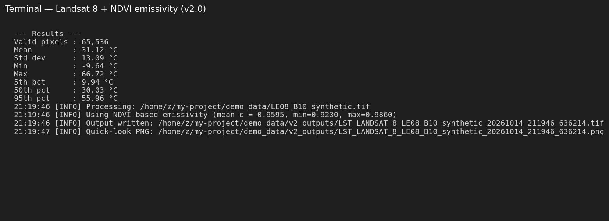
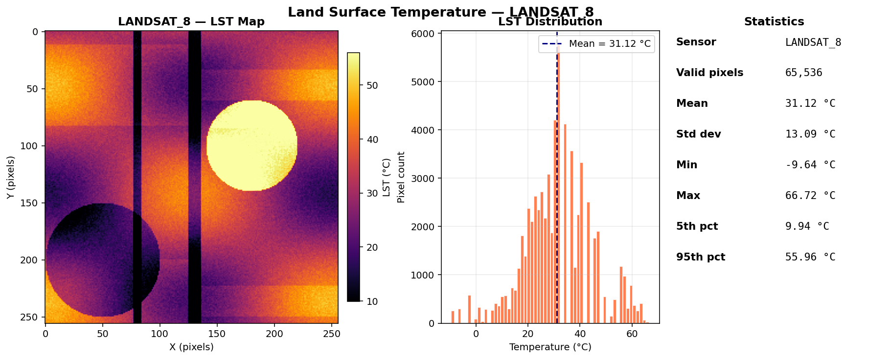
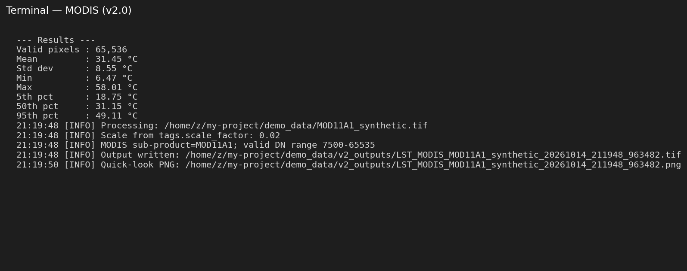
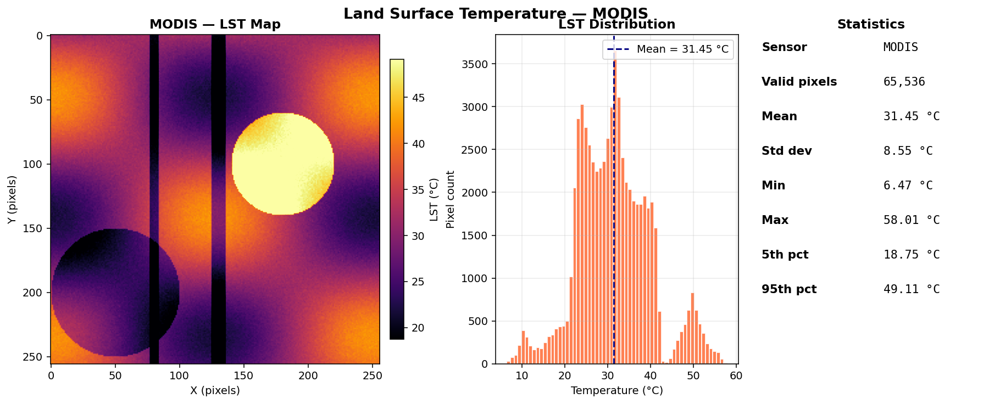

# Automated Land Surface Temperature (LST) Mapping

> **Universal Satellite LST Calculator v2.0** — a sensor-agnostic Python pipeline for retrieving Land Surface Temperature from **Landsat 8/9 (TIRS)**, **ASTER (TIR)**, **MODIS**, and **ECOSTRESS** thermal imagery.

This repository implements a **Registry-Pattern** architecture that handles both raw thermal radiance (Level-1) and pre-computed LST products (Level-2) through a single unified interface. The pipeline applies the **emissivity-corrected Brightness Temperature** method for raw sensors (Sobrino et al., 2004) and **automated metadata-driven scaling** for operational products.

> **v2.0** fixes 16 issues identified in code review and adds CLI args, MTL auto-parsing, NDVI-based emissivity, batch mode, quick-look PNGs, COG output, a sanity filter, and a pytest test suite. See [Changelog](#changelog) for details.

---

## Table of Contents

1. [Screenshots](#screenshots)
2. [Key Features](#key-features)
3. [Installation](#installation)
4. [Quick Start](#quick-start)
5. [Usage Guide](#usage-guide)
6. [Methodology](#methodology)
7. [Outputs](#outputs)
8. [Changelog — v2.0 Fixes](#changelog--v20-fixes)
9. [Recommended Future Additions](#recommended-future-additions)
10. [Testing](#testing)
11. [Citation & References](#citation--references)
12. [License](#license)

---

## Screenshots

### Landsat 8 with NDVI-based emissivity (v2.0)

Non-interactive run with `--red` and `--nir` flags so emissivity is computed per-pixel via the Sobrino NDVITEM method, instead of asking the user for a single scalar.



The auto-generated quick-look PNG (map + distribution + statistics panel):



### MODIS (MOD11A1) — v2.0

The tool auto-detects the `scale_factor` from rasterio's `scales[0]` field (or tags), detects the MODIS sub-product (`MOD11A1`), and applies the correct valid-range filter.





---

## Key Features

* **Multi-Sensor Support:** Single interface for **Landsat 8/9 (TIRS)**, **ASTER (TIR)**, **MODIS**, and **ECOSTRESS**.
* **Honest Method Labelling:** Output metadata reports `METHOD = "Emissivity-Corrected BT"` (not "SCA") since this pipeline does not perform atmospheric correction.
* **Per-Pixel Emissivity:** Three ways to supply ε — scalar (`--emissivity`), per-pixel raster (`--emissivity-raster`), or NDVI-derived (`--red` + `--nir`).
* **Automatic MTL Parsing:** Pass `--mtl path/to/LE08_MTL.txt` and the script pulls `RADIANCE_MULT`, `RADIANCE_ADD`, `K1`, `K2` automatically — no manual typing.
* **Sanity Filter:** Output pixels outside `[-50, 90] °C` are masked as NaN (configurable with `--lst-min` / `--lst-max`).
* **Non-Interactive CLI:** Full argparse interface — supports batch mode and cron jobs.
* **Quick-Look PNG:** `--plot` generates a publication-ready map + histogram + stats panel.
* **Cloud-Optimized GeoTIFF:** `--cog` writes tiled, DEFLATE-compressed output for cloud workflows.
* **CSV Stats Export:** `--csv stats.csv` appends a row per scene for time-series analysis.
* **Unique Output Filenames:** Includes scene ID + microsecond timestamp — never silently overwrites.
* **Test Suite:** 16 pytest tests verify every bug fix.

---

## Installation

### Prerequisites

* Python 3.8+
* `numpy`, `rasterio`
* Optional: `matplotlib` (for `--plot`), `pytest` (for tests)

### Setup

```bash
git clone https://github.com/Bipul-roy-AI/Automated-Land-Surface-Temperature-LST-Mapping.git
cd Automated-Land-Surface-Temperature-LST-Mapping

pip install -r dependencies.txt
```

> The dependency file is now correctly named `dependencies.txt` (was `dependicies.txt` in v1).

---

## Quick Start

### Interactive mode (legacy v1 behavior)

```bash
python lst_universal_research_safe.py
```

### Non-interactive — Landsat 8 with NDVI emissivity

```bash
python lst_universal_research_safe.py \
    --input LE08_B10.tif \
    --mtl LE08_MTL.txt \
    --red LE08_B4.tif \
    --nir LE08_B5.tif \
    --sensor LANDSAT_8 \
    --plot \
    --csv stats.csv
```

### Non-interactive — MODIS

```bash
python lst_universal_research_safe.py \
    --input MOD11A1.tif \
    --sensor MODIS \
    --plot
```

### Batch processing

```bash
python lst_universal_research_safe.py \
    --batch ./scenes/ \
    --sensor LANDSAT_8 \
    --emissivity 0.98 \
    --plot \
    --csv batch_stats.csv
```

---

## Usage Guide

### All CLI flags

```
python lst_universal_research_safe.py --help
```

| Flag | Purpose |
|------|---------|
| `--input, -i` | Path to thermal GeoTIFF |
| `--batch, -b` | Batch mode: process every `*.tif` in this folder |
| `--sensor` | Force sensor (`LANDSAT_8`, `LANDSAT_9`, `ASTER`, `MODIS`, `ECOSTRESS`) |
| `--emissivity` | Scalar surface emissivity (0 < ε ≤ 1) |
| `--emissivity-raster` | Path to per-pixel emissivity GeoTIFF |
| `--red` | Red band GeoTIFF (for NDVI-based ε) |
| `--nir` | NIR band GeoTIFF (for NDVI-based ε) |
| `--mtl` | Landsat `*_MTL.txt` for auto-constants |
| `--band` | Landsat thermal band number (default 10) |
| `--rad-mult`, `--rad-add` | Override RADIANCE_MULT/ADD |
| `--k1`, `--k2` | Override thermal constants |
| `--wavelength` | Override central wavelength (µm) |
| `--ucc` | ASTER Unit Conversion Coefficient |
| `--scale`, `--offset` | Override product scale/offset |
| `--output-dir, -o` | Output directory (default: alongside input) |
| `--plot` | Generate quick-look PNG |
| `--csv` | Append stats to this CSV file |
| `--cog` | Write Cloud-Optimized GeoTIFF |
| `--lst-min`, `--lst-max` | Sanity filter range (default -50 / 90 °C) |
| `--non-interactive` | Never prompt; error if input missing |
| `--verbose, -v` / `--quiet, -q` | Logging level |

### Where do I find the constants?

| Sensor | Source file | Look for |
|--------|-------------|----------|
| Landsat 8 / 9 | `*_MTL.txt` | `RADIANCE_MULT_BAND_10`, `RADIANCE_ADD_BAND_10`, `K1_CONSTANT_BAND_10`, `K2_CONSTANT_BAND_10` — or just pass `--mtl path/to/MTL.txt` and the script reads them automatically |
| ASTER | `*.hdf` metadata | Unit Conversion Coefficient (UCC) per TIR band |
| MODIS (MOD11A1 / MYD11A1) | HDF tags | `scale_factor = 0.02`, `add_offset = 0.0` — auto-detected |
| ECOSTRESS | `*.h5` metadata | `scale_factor` attribute on the LST dataset |

---

## Methodology

### 1. Physics-Based Retrieval (Landsat 8/9 & ASTER)

For raw Digital Numbers (DN), the pipeline reverses the sensor transfer function:

**Step 1 — Spectral Radiance (Lλ):**

*Landsat:*
$$L_\lambda = DN \times \text{RADIANCE\_MULT} + \text{RADIANCE\_ADD}$$

*ASTER:*
$$L_\lambda = (DN - 1) \times \text{UCC}$$

**Step 2 — Brightness Temperature (BT)** via Planck's Law inversion:

$$BT = \frac{K_2}{\ln\!\left(\frac{K_1}{L_\lambda} + 1\right)}$$

**Step 3 — Emissivity Correction (Sobrino 2004):**

$$LST = \frac{BT}{1 + \left(\dfrac{\lambda \cdot BT}{\rho}\right) \ln(\varepsilon)} - 273.15$$

where:
* λ = central wavelength of the thermal band (µm)
* ρ = 14380 µm·K
* ε = surface emissivity (scalar, per-pixel raster, or NDVI-derived)

> **Honest labelling:** This is **not** the full Jiménez-Muñoz & Sobrino (2003) Single-Channel Algorithm, which also requires atmospheric water-vapour functions. We label the output method `"Emissivity-Corrected BT"`, not `"SCA"`. For atmospheric correction, integrate MODTRAN 6.0 or use the split-window algorithm (see [Recommended Additions](#recommended-future-additions)).

### 2. Product-Based Retrieval (MODIS & ECOSTRESS)

Parses internal metadata to apply scale factors and offsets automatically:

$$LST_{°C} = (DN \times \text{scale\_factor} + \text{add\_offset}) - 273.15$$

* Scale/offset read from `src.scales[0]` / `src.offsets[0]` first, then tags, then registry defaults
* **Per-sub-product valid-range filter** for MODIS (`MOD11A1`: 7500–65535, `MOD11_L2`: 0–65535, etc.)
* **UNITS check** for ECOSTRESS: if the input is already in Celsius, the 273.15 subtraction is skipped

### 3. NDVI-based Emissivity (Sobrino NDVITEM)

When `--red` and `--nir` are supplied, the script computes NDVI and derives per-pixel ε:

| NDVI range | Emissivity |
|------------|------------|
| NDVI < −0.185 | 0.995 (water) |
| −0.185 ≤ NDVI < 0.157 | 0.923 (bare soil) |
| 0.157 ≤ NDVI < 0.727 | 0.974 + 0.012 · Pv (mixed) |
| NDVI ≥ 0.727 | 0.986 (full vegetation) |

where `Pv = ((NDVI − 0.157) / (0.727 − 0.157))²` is the fractional vegetation cover.

### 4. Sanity Filter

All output pixels with LST outside `[-50, 90] °C` (configurable) are set to NaN. This catches the bug where DN=0 fill pixels previously produced LST ≈ −125 °C.

---

## Outputs

The pipeline produces a GeoTIFF named `LST_<SENSOR>_<scene>_<timestamp>.tif`, with:

* **dtype:** `float32`
* **nodata:** `-9999`
* **units:** degrees Celsius
* **CRS & transform:** inherited from input
* **embedded tags:** `SENSOR`, `LST_UNITS`, `METHOD`, `GENERATED_BY`, `GENERATED_AT`, `SOURCE_FILE`

### Reading the output in Python

```python
import rasterio
import numpy as np

with rasterio.open("LST_LANDSAT_8_LE08_B10_20251015_153012.tif") as src:
    lst = src.read(1).astype(np.float32)
    lst[lst == -9999] = np.nan
    print(f"Mean LST: {np.nanmean(lst):.2f} °C")
    print(f"Sensor: {src.tags()['SENSOR']}")
    print(f"Method: {src.tags()['METHOD']}")
```

---

## Changelog — v2.0 Fixes

All 16 issues from the code review are addressed:

### Bugs that change results

| # | Issue | Fix |
|---|-------|-----|
| 1 | Landsat fill pixels (DN=0) leaked through as −125 °C | Mask `dn == 0` and `src.nodata` BEFORE radiance conversion |
| 2 | ECOSTRESS: no valid-range filter, no UNITS check | Added valid-range filter + `UNITS` tag check (Kelvin vs Celsius) |
| 3 | Single scalar emissivity for whole image | Support `--emissivity-raster` and `--red`+`--nir` (NDVI method) |
| 4 | Bad emissivity only warned, not blocked | Hard-reject ε ≤ 0 or ε > 1 with `ValueError` |
| 5 | No sanity filter on output | Added `apply_sanity_filter()` — default `[−50, 90] °C`, configurable |
| 6 | METHOD tag mislabeled as `"SCA (RAW)"` | Renamed to `"Emissivity-Corrected BT"` |

### Method & labelling

| # | Issue | Fix |
|---|-------|-----|
| 7 | "Hyperspectral" wrong word | README says "atmospheric correction" |
| 8 | Landsat wavelength 10.8 µm | Changed to **10.9 µm** (USGS effective wavelength) |

### Robustness

| # | Issue | Fix |
|---|-------|-----|
| 9 | Sensor detection fragile (ASTER ↔ MASTER, LC08 before LC09) | Word-boundary regex; checks filename, dataset tags, and band-1 tags |
| 10 | Scale/offset only from tags | Now reads `src.scales[0]` / `src.offsets[0]` first, then tags, then defaults |
| 11 | `except Exception` swallows errors | Replaced with `logger.exception()` + non-zero exit code |
| 12 | Output filename not unique | Now `LST_<SENSOR>_<scene>_<YYYYMMDD_HHMMSS_µs>.tif` |

### README & repo

| # | Issue | Fix |
|---|-------|-----|
| 13 | README said `python universal_lst.py` | Corrected to `python lst_universal_research_safe.py` |
| 14 | Usage code fence never closed | Closed |
| 15 | `dependicies.txt` typo + no version pins | Renamed to `dependencies.txt` with version pins |
| 16 | "Enforces physical guardrails" overclaim | Softened to "sanity check" |

### Functionality additions

| Feature | How to use |
|---------|------------|
| **argparse CLI** | `--input`, `--sensor`, `--emissivity`, `--mtl`, `--red`, `--nir`, etc. |
| **MTL auto-parsing** | `--mtl LE08_MTL.txt` reads `RADIANCE_MULT`/`ADD`, `K1`, `K2` automatically |
| **NDVI-based emissivity** | `--red B4.tif --nir B5.tif` — Sobrino NDVITEM method |
| **Per-pixel emissivity raster** | `--emissivity-raster eps.tif` |
| **Batch mode** | `--batch ./scenes/` |
| **Quick-look PNG** | `--plot` |
| **CSV stats export** | `--csv stats.csv` |
| **Cloud-Optimized GeoTIFF** | `--cog` |
| **Logging** | `--verbose` / `--quiet` |
| **pytest test suite** | 16 tests covering every bug fix |

---

## Recommended Future Additions

These were suggested but not yet implemented, in priority order:

| Priority | Feature | Why |
|----------|---------|-----|
| High | **Real SCA with atmospheric functions** (Jiménez-Muñoz 2003) — needs water vapour input | Removes the 2–5 K atmospheric error |
| High | **Split-Window Algorithm** for Landsat 8 (B10 + B11) | ~0.5 K accuracy without atmosphere data. Note: USGS warns about B11 stray-light |
| High | **Landsat Collection 2 Level-2 `ST_B10`** as a product type | USGS already provides surface temperature; useful for validation |
| High | **Cloud masking** with `QA_PIXEL` for Landsat, QC bands for MODIS/ECOSTRESS | Removes cloudy pixels from stats |
| Medium | **Clip to AOI** (shapefile / GeoJSON) + reproject | Aligns multi-sensor products |
| Medium | **Zonal statistics** per polygon, LST vs NDVI/NDBI, UHI/UTFVI indices | Common research use case |
| Medium | **Validation** against MODIS LST or station data; report bias/RMSE | Critical for published research |
| Medium | **Hot-spot analysis** (Getis-Ord Gi*) | Urban heat island studies |
| Low | **Time-series mode** (folder of LSTs → trend map) | Drought monitoring |
| Low | **Streamlit web UI** | Non-Python users |
| Low | **Sentinel-3 SLSTR support** | Additional free TIR sensor |

---

## Testing

The `tests/` folder contains 16 pytest tests that verify every bug fix. Run them with:

```bash
pip install pytest
pytest tests/ -v
```

Expected output:

```
tests/test_lst_pipeline.py::TestBugFixes::test_bug_1_fill_pixels_masked PASSED
tests/test_lst_pipeline.py::TestBugFixes::test_bug_2_ecostress_units_check PASSED
tests/test_lst_pipeline.py::TestBugFixes::test_bug_4_invalid_emissivity_rejected PASSED
tests/test_lst_pipeline.py::TestBugFixes::test_bug_5_sanity_filter PASSED
tests/test_lst_pipeline.py::TestBugFixes::test_bug_6_method_label_honest PASSED
tests/test_lst_pipeline.py::TestBugFixes::test_bug_8_landsat_wavelength PASSED
tests/test_lst_pipeline.py::TestBugFixes::test_bug_9_sensor_detection_no_master_clash PASSED
tests/test_lst_pipeline.py::TestBugFixes::test_bug_9_filename_detection PASSED
tests/test_lst_pipeline.py::TestBugFixes::test_bug_10_scale_from_rasterio_field PASSED
tests/test_lst_pipeline.py::TestBugFixes::test_bug_12_unique_output_filename PASSED
tests/test_lst_pipeline.py::TestNewFunctionality::test_ndvi_emissivity PASSED
tests/test_lst_pipeline.py::TestNewFunctionality::test_mtl_parser PASSED
tests/test_lst_pipeline.py::TestNewFunctionality::test_cli_args_parsed PASSED
tests/test_lst_pipeline.py::TestNewFunctionality::test_batch_mode PASSED
tests/test_lst_pipeline.py::TestNewFunctionality::test_end_to_end_landsat_with_ndvi PASSED
tests/test_lst_pipeline.py::TestNewFunctionality::test_end_to_end_modis PASSED

16 passed
```

---

## Citation & References

If you use this tool in published research, please cite:

* **Sobrino, J. A., Jiménez-Muñoz, J. C., & Paolini, L. (2004).** *Land surface temperature retrieval from LANDSAT TM 5.* Remote Sensing of Environment, 90(4), 434–440. https://doi.org/10.1016/j.rse.2004.02.003
* **Jiménez-Muñoz, J. C., & Sobrino, J. A. (2003).** *A generalized single-channel method for retrieving land surface temperature from remote sensing data.* Journal of Geophysical Research, 108(D22). https://doi.org/10.1029/2003JD003480
* **USGS (2023).** *Landsat 8-9 Collection 2 Level 1 Data Products.* https://www.usgs.gov/landsat-missions/landsat-8-9-collection-2-level-1-data
* **MODIS Land Surface Temperature Team.** *MOD11A1 MODIS/Terra Land Surface Temperature/Emissivity Daily L3 Global 1 km SIN Grid.* https://lpdaac.usgs.gov/products/mod11a1v061/

---

## License

MIT License — see the [LICENSE](LICENSE) file for details.
